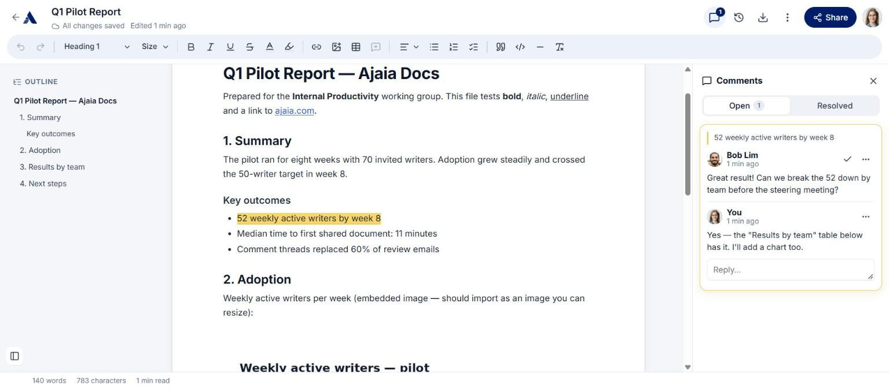

# Ajaia Docs

A collaborative document editor: write with rich formatting and images, share with editors, commenters or viewers, discuss in comment threads anchored to text, see who else is in the document, and roll back to any earlier version.

**Live demo:** https://ajaia-docs-gilt-xi.vercel.app · **Walkthrough video:** see [`VIDEO_URL.txt`](VIDEO_URL.txt) · **Submission report:** [`SUBMISSION_REPORT.pdf`](SUBMISSION_REPORT.pdf)



## Demo accounts

All three demo users have profile photos; anyone without one falls back to coloured initials.


Sign-in is mocked: choose an account on the login page (no password). Open a second browser or a private window to be two people at once.

| User | Email | Seeded state |
|---|---|---|
| Alice Tan | alice@ajaia.test | Owns **Welcome to Ajaia Docs** · **commenter** on Bob's Q4 Launch Plan |
| Bob Lim | bob@ajaia.test | Owns **Q4 Launch Plan** (with a comment thread) · **editor** on Alice's welcome doc |
| Chris Ng | chris@ajaia.test | **Viewer** on the launch plan — use him to try sharing |

## Features

**Editing**
- Create from blank or a template (meeting notes, project brief, retro), rename, autosave (~1 s after typing stops, `Ctrl/Cmd+S` to force), delete (owner).
- Bold, italic, underline, strikethrough, text colour, highlight, font size, Heading 1–3, alignment, bulleted / numbered lists, checklists, quotes, code blocks, dividers, links (`Ctrl/Cmd+K`).
- **Tables** with a contextual toolbar (add/remove rows and columns, header row, merge/split, resizable columns).
- **Images**: toolbar button, paste, or drag-and-drop; resizable from the corners. PNG, JPEG, GIF, WebP up to 3 MB.
- **`/` command menu** for inserting any block from the keyboard, a selection toolbar, a live **outline** of headings, and word/character counts.

**Files**
- Import **`.txt`, `.md` or `.docx`** (max 4 MB) as a new document. Headings, emphasis, lists — and **images embedded in Word files** — are preserved. Other types are rejected with a clear message.
- Download as Markdown, HTML, or Print → PDF.

**Collaboration**
- Share by email as **Editor**, **Commenter** or **Viewer**; change roles or remove access. The documents page separates **My documents** from **Shared with me**, with search, sort, role badges and preview cards.
- **Comments**: select text → comment. Threads with replies, resolve/reopen, delete; highlights in the text follow edits, and a thread is marked "text changed" if its passage is edited away.
- **Version history**: each editing session is a version (who, when, word count). Preview any version and restore it — restoring adds a new version, so nothing is lost.
- **Presence**: avatars of who's in the document and who's actively editing; collaborators' saved changes and new comments appear within ~4 s.
- **Conflict safety**: simultaneous saves never silently overwrite each other (version check → "Load their version / Keep mine").
- **Activity feed** on the home page: shares, comments, edits, restores across your documents.

All permissions are enforced on the server. People without access get a 404, including for image URLs.

## Sample files

`sample-files/` has a Word report (headings, table, link, embedded chart), Markdown notes, a plain-text file, two images for insert/paste/drag-drop, and an unsupported `.csv`. See [`sample-files/README.md`](sample-files/README.md) for a 10-minute test script.

## Run locally

Requires **Node.js 22** (22.12 or newer).

```bash
npm install
cp .env.example .env.local   # optional — defaults work for local dev
npm run dev                  # http://localhost:3000
```

Data lives in a SQLite file at `data/app.db`, created, migrated and seeded on first request. Delete it to reset to the demo state.

### Tests

```bash
npm test             # 31 unit/integration tests (Vitest, in-memory SQLite), ~2 s
npm run test:e2e     # 6 browser tests (Playwright) against a production build on :3100
npm run typecheck
```

`npm run test:e2e` needs Chromium: run `npx playwright install chromium` once, or set `PW_CHROMIUM_PATH` to an existing binary.

| File | Covers |
|---|---|
| `tests/documents.test.ts` | CRUD, formatting round-trip, validation, stale-version conflicts, owned vs shared listing, 404 for non-shared users, editor/viewer permissions, re-share, unshare, delete |
| `tests/collaboration.test.ts` | Commenter role, comment threads & resolve rules, version grouping & restore, image upload/serve permissions and magic-byte checks, sanitizer allow-list, presence, activity scoping, cascade delete, **upgrading a database from the first release's schema** |
| `tests/import.test.ts` | `.txt`, `.md`, generated `.docx`, a real Word file with an embedded image, script stripping, error cases |
| `e2e/core-flow.spec.ts` | Two- and three-user browser flows: create/format/reload/share/view-only/live update/presence · slash menu, tables, checklists, image upload + access check · commenter comments → owner replies & resolves · history preview & restore propagating to another editor · Markdown import · rejected upload |

## Deploy (free: Vercel + Turso)

libSQL means the same code talks to a local SQLite file in development and a hosted [Turso](https://turso.tech) database (free tier) in production.

1. **Database:** create a Turso database, copy its `libsql://…` URL and create a token (Read & Write, no expiry).
2. **Vercel:** import the GitHub repo (Next.js is auto-detected). Node version comes from `package.json` (22.x).
3. **Environment variables:**

   | Name | Value |
   |---|---|
   | `DATABASE_URL` | `libsql://<db>-<org>.turso.io` |
   | `DATABASE_AUTH_TOKEN` | the Turso token |
   | `SESSION_SECRET` | a long random string |

4. **Deploy.** Migrations and demo data run automatically on first request. An existing database from an earlier release is upgraded in place.

## Project layout

```
src/
  app/                    pages + API routes (thin: auth → service → JSON)
    api/documents/[id]/   CRUD · shares · comments · versions · assets · sync
    api/assets/[id]       access-checked image serving
    api/import · activity · session · users
  components/
    editor/               DocumentEditor (save queue, sync), Toolbar, SelectionMenu, slash menu,
                          comment highlights, Comments/History/Outline panels, Share dialog
    home/                 documents page, cards, templates, activity feed
    ui/                   avatars, menus, toasts, logo
  lib/                    domain logic — every rule lives here and is unit-tested
    access.ts             role → permission matrix (single source of truth)
    documents.ts · comments.ts · versions.ts · assets.ts · presence.ts · activity.ts
    import.ts · sanitize.ts · db.ts (migrations) · seed.ts · auth.ts
tests/  e2e/  docs/screenshots/
```

See [ARCHITECTURE.md](ARCHITECTURE.md) for design decisions and trade-offs, and [AI_WORKFLOW.md](AI_WORKFLOW.md) for how AI was used.
