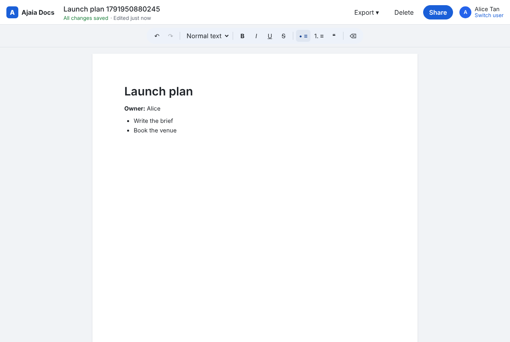

# Ajaia Docs

A lightweight collaborative document editor: create and format documents, import files, share with teammates as editors or viewers, and pick up each other's changes.

**Live demo:** _<add Vercel URL>_ · **Walkthrough video:** see [`VIDEO_URL.txt`](VIDEO_URL.txt)



## Demo accounts

Sign-in is mocked: choose an account on the login page (no password).

| User | Email | Seeded state |
|---|---|---|
| Alice Tan | alice@ajaia.test | Owns "Welcome to Ajaia Docs" |
| Bob Lim | bob@ajaia.test | Has **edit** access to Alice's welcome doc |
| Carol Ng | carol@ajaia.test | Nothing shared yet — use her to test sharing |

To test sharing, open two browsers (or one normal + one private window) and sign in as different users. "Switch user" in the top right returns to the account picker.

## Features

- **Documents:** create, rename (click the title), edit, delete (owner only). Autosaves ~1 s after you stop typing; `Ctrl/Cmd+S` saves immediately. Save status is always visible.
- **Rich text:** bold, italic, underline, strikethrough, Heading 1–3, bulleted and numbered lists, quotes, undo/redo, clear formatting. Standard keyboard shortcuts and Markdown shortcuts (`# `, `- `, `1. `) work.
- **File import:** upload a **`.txt`, `.md` or `.docx`** file (max 4 MB) to create a new editable document. Headings, emphasis and lists are preserved. Other file types are rejected with a clear message.
- **Sharing:** owners share by email as **Can edit** or **Can view**, change roles, or remove access. The documents page separates **My documents** from **Shared with me**, with owner and role badges.
- **Access control** enforced on the server: viewers get a read-only editor and the API refuses their writes; people without access get a 404.
- **Collaboration safety:** concurrent edits never silently overwrite each other (version check → "Load their version / Keep mine"). Open documents pick up collaborators' saved changes within ~5 s.
- **Export:** Markdown, HTML, or Print → Save as PDF.

## Run locally

Requires Node.js 20.9+.

```bash
npm install
cp .env.example .env.local   # optional — defaults work for local dev
npm run dev                  # http://localhost:3000
```

Data is stored in a SQLite file at `data/app.db`, created and seeded automatically on first request. Delete that file to reset to the seeded state.

### Tests

```bash
npm test             # unit/integration tests (Vitest, in-memory SQLite) — ~1 s
npm run test:e2e     # browser end-to-end tests (Playwright) — builds and starts the app on :3100
npm run typecheck
```

`npm run test:e2e` needs a Chromium for Playwright: run `npx playwright install chromium` once, or set `PW_CHROMIUM_PATH` to an existing Chromium binary.

What the tests cover:

- `tests/documents.test.ts` — create/rename/edit/reopen with formatting intact, HTML sanitisation, validation, stale-version conflicts, owned vs shared listing, 404 for non-shared users, editor vs viewer permissions, re-sharing, unsharing, delete.
- `tests/import.test.ts` — `.txt`, `.md` and a real generated `.docx` converted to editor HTML; script stripping; unsupported/empty/corrupt file errors.
- `e2e/core-flow.spec.ts` — full browser flow: Alice creates and formats a doc → reload persists it → shares with Carol as viewer → Carol sees it under "Shared with me", read-only → Alice's next edit appears in Carol's open tab. Plus Markdown import and a rejected upload.

## Deploy (free: Vercel + Turso)

The app uses libSQL, so the same code talks to a local SQLite file in development and a hosted [Turso](https://turso.tech) database (free tier, SQLite-compatible) in production. Vercel's filesystem is ephemeral, so a hosted database is required there.

1. **Create the database** (Turso dashboard, or CLI):
   ```bash
   turso db create ajaia-docs
   turso db show ajaia-docs --url      # → libsql://ajaia-docs-<you>.turso.io
   turso db tokens create ajaia-docs   # → auth token
   ```
2. **Import the repo in Vercel** (New Project → select the GitHub repo; framework is auto-detected).
3. **Set environment variables:**
   | Name | Value |
   |---|---|
   | `DATABASE_URL` | the `libsql://…` URL |
   | `DATABASE_AUTH_TOKEN` | the token |
   | `SESSION_SECRET` | any long random string (e.g. `openssl rand -hex 32`) |
4. **Deploy.** Tables and demo users are created automatically on the first request.

If `DATABASE_URL` is missing on Vercel the app still boots, using a temporary SQLite file in `/tmp` — fine for a smoke test, but data won't persist between instances.

## Project layout

```
src/
  app/                 Next.js App Router pages + API routes (thin: auth → service → JSON)
    api/documents/…    CRUD, sharing
    api/import/        file upload → new document
    api/session/       mock sign-in / sign-out
  components/          Editor, toolbar, share dialog, documents home
  lib/
    documents.ts       domain logic + access control (all rules live here)
    import.ts          .txt/.md/.docx → sanitised HTML
    sanitize.ts        HTML allow-list
    db.ts              libSQL client, schema, seed
    auth.ts            signed-cookie mock auth
tests/                 Vitest
e2e/                   Playwright
```

See [ARCHITECTURE.md](ARCHITECTURE.md) for design decisions and trade-offs, and [AI_WORKFLOW.md](AI_WORKFLOW.md) for how AI was used.
